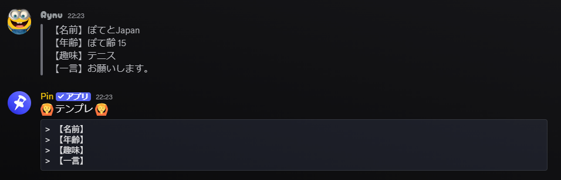

# 🤖 Pin

:::warning

Pin留めメッセージにビビらないでください。
このBOTは、同じメッセージを一番下に固定しているだけです！

:::

## 名称

Pin（ピン）

## 説明

このBOTは特定のメッセージをチャンネルの一番下に固定することができます。

例えば、`#自己紹介`チャンネルで自己紹介文のテンプレートをユーザーに表示させたい場合、以下のように設定することができます。

## 導入

こちらのリンクからBOTをサーバーに招待することができます。

https://discord.com/oauth2/authorize?client_id=1299604436577943572

## 必要権限について

Pin は以下の権限を要求しています。

- チャンネルを見る
   - Pin がチャンネルにアクセスする為
- メッセージを送信
   - ピン留めメッセージを送信する為
- メッセージを管理
   - ピン留めして不要になったメッセージを削除する為
- 埋め込みリンク
   - ピン留めメッセージに埋め込みリンクを含める為
- ファイルを添付
   - ピン留めメッセージにファイルを含める為
- メッセージ履歴を見る
   - ピン留めするメッセージを取得する為
- リアクションの追加
   - ピン留めできなかった際に、リアクションをメッセージ追加する為
- 外部のスタンプを使用する
   - ピン留めメッセージに外部のスタンプを含める為
